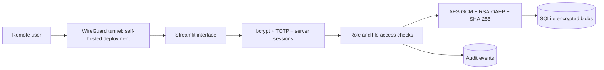

# CipherVault — Secure Remote File Vault

A working Python / Streamlit cybersecurity project implementing password + TOTP MFA, server-side RBAC, hybrid encryption, integrity verification and audit logs. Based on the Secure Remote File Vault synopsis for Computer and Cyber Security Fundamentals, JIIT Noida.

**Live demonstration:** https://cipher-vault-arihant.streamlit.app/

## Run locally

```powershell
python -m venv .venv
.\.venv\Scripts\Activate.ps1
pip install -r requirements.txt
python setup_vault.py --local
python -m streamlit run app.py
```

Read the bootstrap token from the newly created, ignored `.streamlit/secrets.toml`, enter it on the setup screen, choose an administrator password and scan the QR code using an authenticator. Confirm with the current code. Sign in using the next unused authenticator code. No default credentials or seed accounts exist.

## Features

- bcrypt salted password hashes; 12-character minimum; 72-byte maximum.
- Encrypted TOTP seeds; 30-second codes; replay rejection; five failed attempts trigger a five-minute account lockout.
- Opaque server-side sessions, hashed session tokens at rest, 30-minute expiry, logout and account deactivation.
- Admin: all files, upload/download/delete, provision/deactivate users, inspect/export audit events.
- Employee: upload, list/download own and team-shared files. Cannot delete or administer.
- Guest: list shared file metadata only. Cannot upload/download/delete.
- Fresh AES-256-GCM key and 96-bit random nonce per upload. File ID is authenticated additional data.
- RSA-3072 OAEP with SHA-256 wraps AES keys. An encrypted PKCS#8 private key is stored in SQLite.
- GCM authentication and SHA-256 plaintext verification before download; modified files are blocked.
- SQLite stores encrypted file blobs and metadata transactionally. No filesystem paths are taken from uploads.
- Audit dashboard and CSV export; search; storage metrics; account management; no external analytics.
- Stitch-inspired navy workspace with cyan/violet accents, responsive file cards, a cryptographic inspector, dashboard file-type chart, and role-scoped recent activity.
- Animated Three.js sign-in vault, bundled locally with pause, reduced-motion support and a WebGL fallback.
- Batch integrity verification of filtered files, per-file failure reporting, and manifest refresh.
- Search by filename/owner; filter by type, ownership and sharing; sort and paginate large file lists.
- Owners and administrators can change file sharing. Integrity can be verified separately from downloading.
- Account page lists active sessions and signs out other sessions. Security center displays a stable public-key fingerprint and the access policy.
- Filter audit events by actor, outcome and action; CSV exports escape spreadsheet formula prefixes.

## Deployment

See [deployment instructions](docs/DEPLOYMENT.md) for Streamlit Community Cloud and persistent Docker/WireGuard deployment. Community Cloud is suitable for a presentation/demo: its local disk is ephemeral and it does not provide VPN-only application access. The Docker deployment is the route for demonstrating the full VPN layer and durable storage.

An optional `render.yaml` Blueprint configures a paid Python service with a 1 GB persistent disk, generated secret values and a health check. It is not automatically provisioned. Review the current price in Render before creating it. A new Blueprint starts a new vault; existing files/accounts are not automatically migrated.

## Test

```powershell
pip install -r requirements-dev.txt
python -m pytest -q
```

Tests exercise encryption round trips and restart, ciphertext/key/hash/nonce tampering, all three roles, cross-account isolation, denied-action logging, OTP replay, lockout, logout, expiry, deactivation, encrypted seeds, wrong master keys and initial UI rendering. GitHub Actions runs the tests on every push and pull request.

UI regression tests also cover filtered inspector selection, mixed successful/failed batch verification and guest metadata-only controls. See [the design notes](DESIGN.md) for the supplied design's adaptation and bundled asset licenses.

## Architecture



`app.py` is the interface, `vault.py` is the security/persistence boundary. The UI never grants authority by itself: operations revalidate a database-backed session and current role. Credentials and data are ignored by Git and Docker's build context.

## Limitations and recovery

Educational prototype, not an independently audited enterprise vault. Server administrators with the master key can decrypt data. Names, ownership, sizes, timestamps and hashes are stored as plaintext metadata. Audit logs can be modified by an operator with database access; use a remote append-only log collector for stronger assurance. The account lockout can be abused for denial of service; production hosting should also enforce network-level rate limits. Metadata is not cryptographically signed. Memory contains plaintext during processing; files are limited to 20 MiB.

Back up the whole data directory and master key separately. Never rotate or replace the master key without a data/key migration. Master-key loss makes data unrecoverable. No self-service MFA recovery is provided: an administrator can deactivate a lost account and provision a replacement; existing file ownership requires a controlled operator migration. Keep at least one administrator's MFA recovery material securely offline. TOTP requires synchronized device/server clocks.

## References

- [Streamlit deployment](https://docs.streamlit.io/deploy/streamlit-community-cloud/deploy-your-app/deploy)
- [Cryptography AESGCM](https://cryptography.io/en/latest/hazmat/primitives/aead/)
- [Cryptography RSA / OAEP](https://cryptography.io/en/latest/hazmat/primitives/asymmetric/rsa/)
- [TOTP RFC 6238](https://www.rfc-editor.org/rfc/rfc6238)
- [WireGuard quick start](https://www.wireguard.com/quickstart/)
