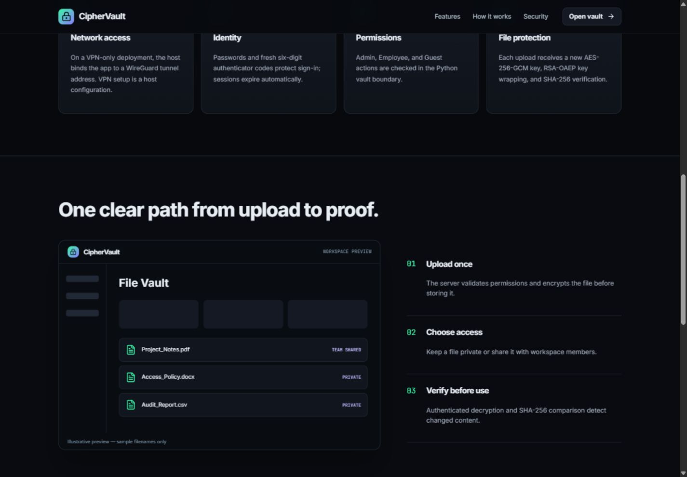
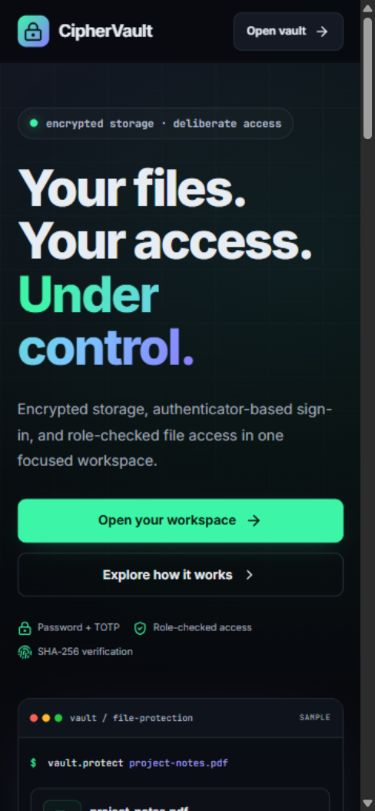
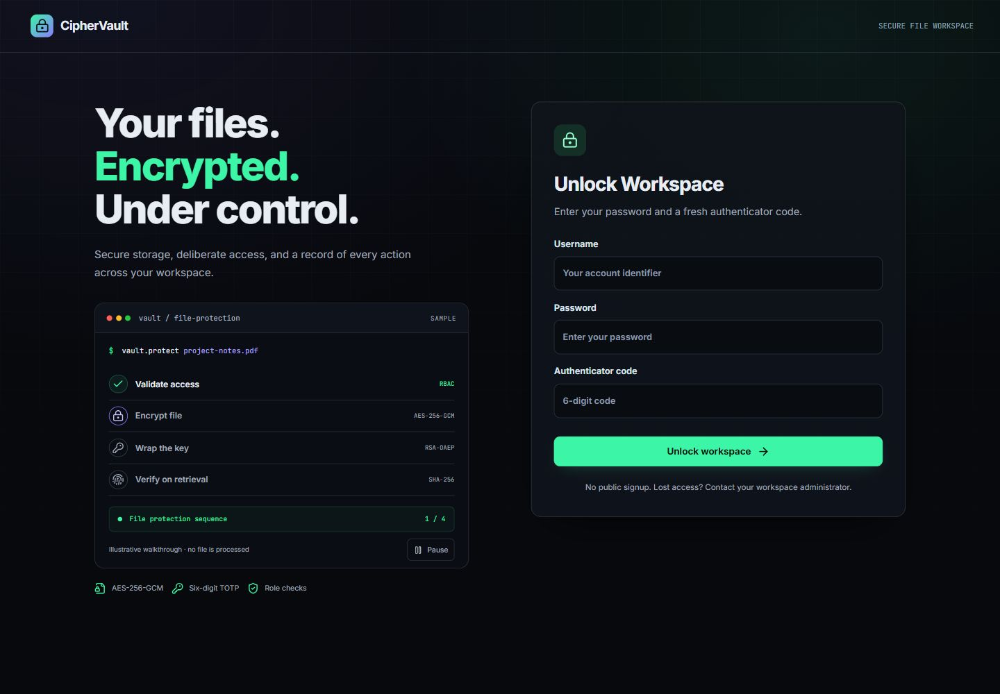
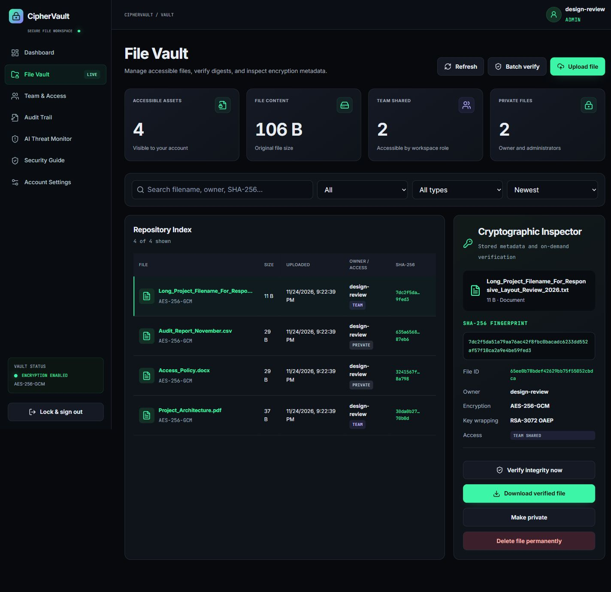

# CodeInspectorAi reference redesign verification

Verified locally on 2026-11-24 using a disposable vault, synthetic files and an isolated administrator account. No deployed credentials or vault data were used.

## Automated checks

- Frontend: 18 Vitest tests passed, including finite walkthrough progression, pause/resume/replay, timer cleanup, reduced-motion changes, observer fallback, mobile focus/keyboard handling and resize cleanup.
- Production frontend build passed.
- Backend: 42 pytest tests passed. One upstream Starlette/httpx deprecation warning; no backend source changes.
- Legacy Streamlit scene: 2 Node tests passed.
- Git whitespace check passed.

## Browser checks

- Compared the live CodeInspectorAi landing page and dashboard with the reference source.
- Inspected landing and sign-in at 1440px and 390px.
- Checked all seven signed-in routes at 1440px and 390px: dashboard, file vault, team, audit, monitoring, guide and account. No page-level horizontal overflow or API errors in the checked states.
- Checked file vault at 1280px and 320px, upload dialog at 320px, drawer open/close/Escape and mobile-to-desktop resize cleanup.
- Completed local password/TOTP login and real file-integrity verification. Exercised the isolated synthetic monitoring demonstration.
- Fixed long-filename success-message wrapping and the mobile sign-in heading after inspection.

Full-page mobile browser capture tooling can reflow a page when it removes its scrollbar. Final mobile review evidence uses viewport captures to preserve the actual layout. Tables intentionally scroll inside their containers.

## Review evidence

Backend security, deployed infrastructure and the separate Streamlit interface are unchanged. These checks establish the listed local behaviors, not a security certification or an exhaustive device audit.
